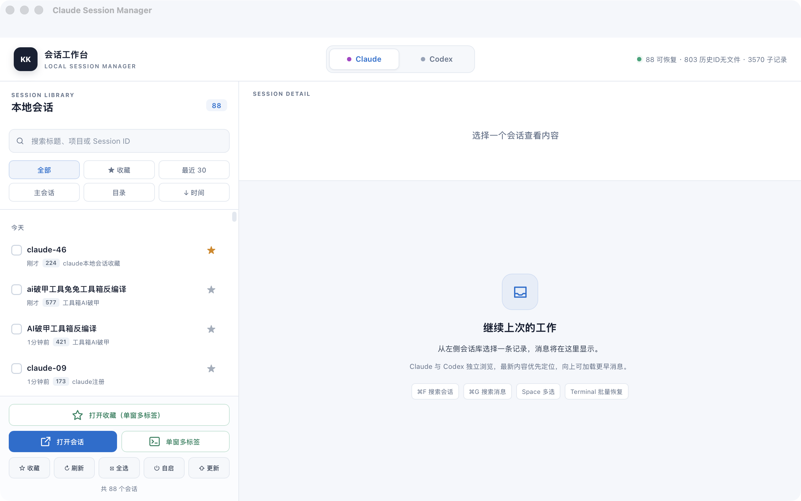
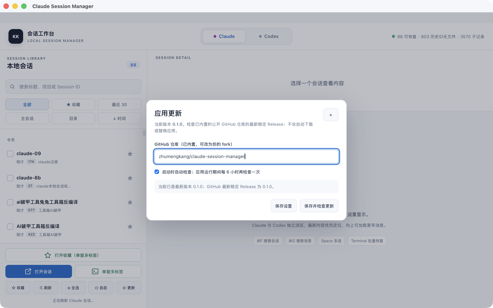
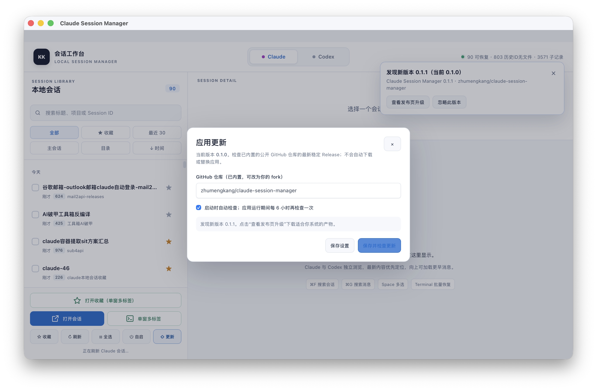
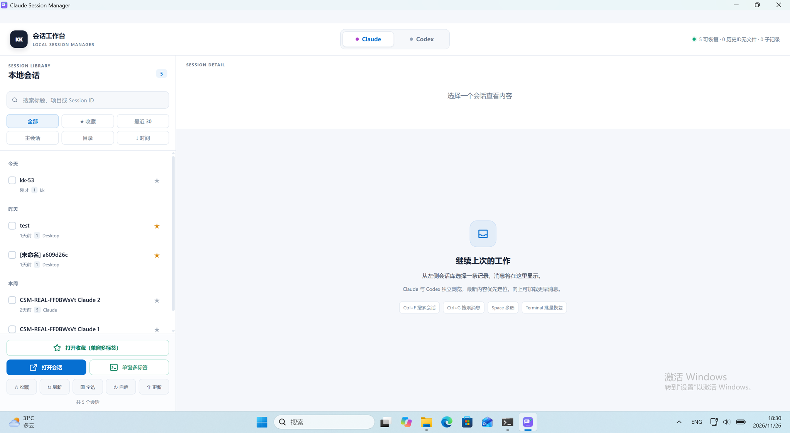
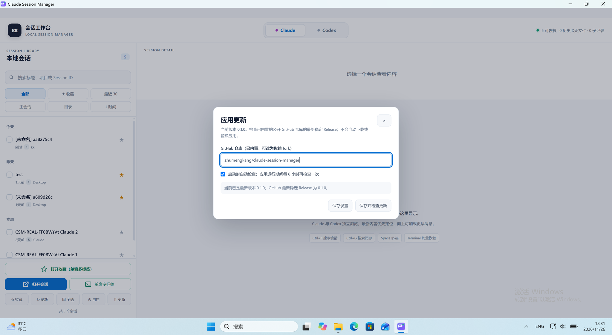
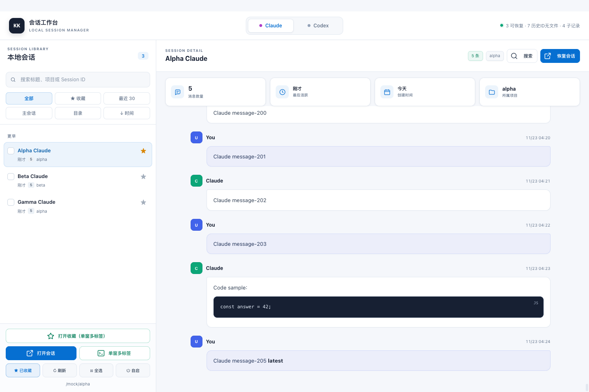
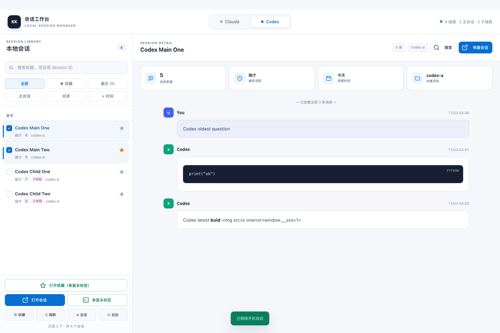
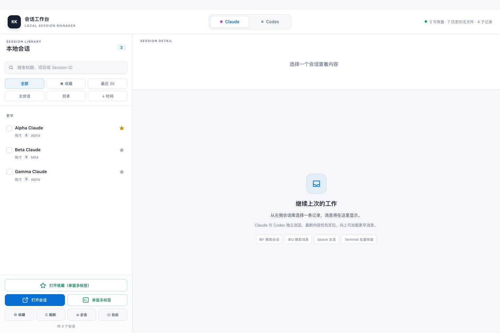
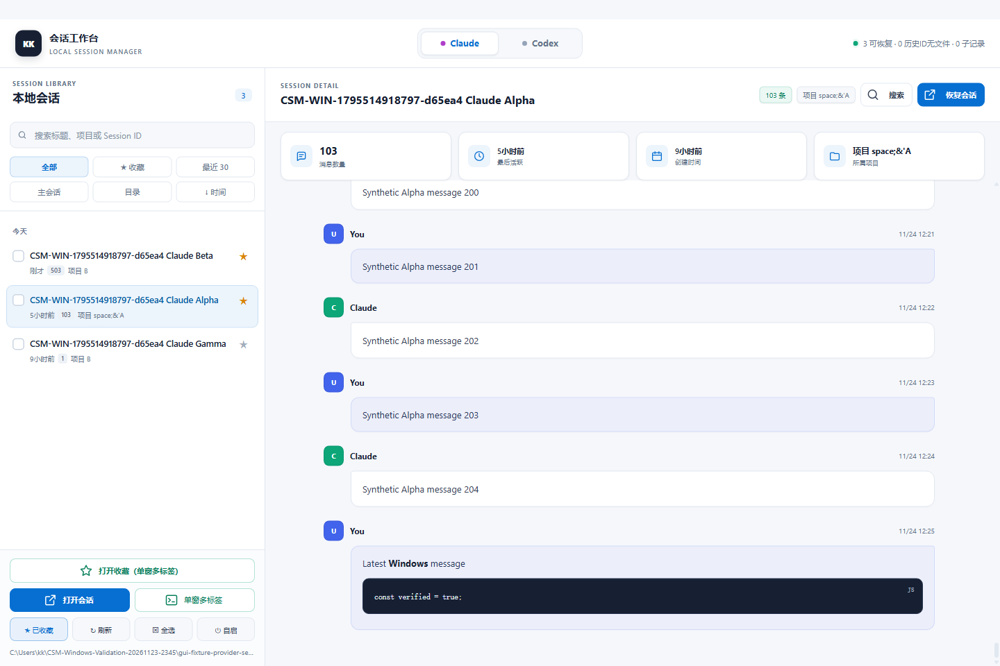

<p align="center">
  
</p>

<h1 align="center">Claude Session Manager</h1>

<p align="center">
  <b>Claude Code 与 Codex 的本地会话管理器</b><br>
  把散落在各个项目里的历史会话收进一个干净、快速的白色桌面应用：<br>
  统一浏览、搜索、收藏、查看完整消息、导出 Markdown，一键恢复，或在一个窗口里多标签批量打开。
</p>

<p align="center">
  
  
  
</p>

<p align="center">
  
</p>

## 这是什么

**Claude Session Manager** 是一个用 **Rust + Tauri 2** 编写的本地桌面应用，用来管理 **Claude Code** 和 **Codex** 的会话历史。它自动扫描本机所有项目目录，把散落的会话集中到一个白色 GUI 里，让你不用记 Session ID、不用翻目录，就能找到、看懂并恢复任意一次对话。

- **统一会话库**：Claude Code 与 Codex 双来源，按项目自动分组。
- **找得到**：关键词搜索、时间 / 收藏过滤、全选与多选。
- **看得清**：最新消息优先，向上加载更早历史，支持 Markdown、代码块与会话内搜索。
- **带得走**：一键导出 Markdown，复制 Session ID、项目路径或文件路径。
- **恢复快**：单会话直接打开；多个会话可在**一个新原生窗口里用多标签批量打开**。
- **本地优先**：没有远程服务后端，UI 不加载运行时 CDN；除更新检查外不联网。
- **有更新提醒**：内置公开仓库，发现更高稳定版本时显示横幅并打开发布页，不自动下载或安装。

## 界面预览

| macOS 实机：更新面板 | macOS 实机：发现新版本 |
| --- | --- |
|  |  |

| Windows 11 ARM64 实机界面 | Windows 实机：更新面板 |
| --- | --- |
|  |  |

| 会话详情、Markdown 与代码块 | Codex 主会话与子线程 |
| --- | --- |
|  |  |

> 实机截图来自作者本机的 macOS / Windows 安装版，只显示会话标题，不含消息正文、凭据或完整路径；其余截图为前端渲染的演示数据。

## 快速开始

| 我想 | 去哪里 |
| --- | --- |
| 第一次安装，照着做 | [docs/INSTALL.md](docs/INSTALL.md)（含安装前检查、逐步骤操作和常见卡点） |
| 安装 macOS Apple Silicon 版 | [docs/INSTALL.md · macOS 安装 DMG](docs/INSTALL.md#2-macos-安装-dmg) |
| 安装 Windows 11 ARM64 版 | [docs/INSTALL.md · Windows 安装](docs/INSTALL.md#3-windows-11-arm64-安装与首次启动) |
| 第一次从源码编译 | [docs/BUILD.md · 从零开始](docs/BUILD.md#0-从零开始第一次编译照着做) |
| 更新已安装的旧版本 | [docs/DEPLOYMENT.md · 已有安装如何更新到新版本](docs/DEPLOYMENT.md#已有安装如何更新到新版本) |
| 从源码编译（环境已就绪） | [docs/BUILD.md](docs/BUILD.md) |

> **安装包由作者在 [GitHub Releases](https://github.com/zhumengkang/claude-session-manager/releases) 页单独上传，本仓库只托管源码。** 发布页暂时没有 DMG / NSIS 时，说明该版本尚未上传二进制，可等待上传或按 [源码编译](docs/BUILD.md) 自行构建。当前已验收的安装版本为 `0.1.0`（macOS Apple Silicon、Windows 11 ARM64），源码 main 为 `0.1.1`。

**GitHub 仓库边界：** 本目录是源码专用 Git 根目录，只允许提交源码、锁文件、测试、文档及必要源码资源；DMG、App、EXE、MSI、压缩包、构建产物和真实会话数据不得进入 Git。二进制附件只由项目所有者在 GitHub Release 单独上传，规则见 [GitHub 源码专用仓库与附件隔离](docs/GITHUB_SOURCE_ONLY.md)。

## 文档导航

| 需求 | 文档 |
| --- | --- |
| **按任务查找全部文档** | **[docs/README.md](docs/README.md)** |
| **安装文件、macOS/Windows 首次启动与授权** | **[docs/INSTALL.md](docs/INSTALL.md)** |
| 浏览、收藏、详情、单开、单窗多标签、导出 | **[docs/USAGE.md](docs/USAGE.md)** |
| **GitHub 新版本检查、升级横幅与忽略版本** | **[docs/UPDATES.md](docs/UPDATES.md)** |
| 更新、自启动、卸载、回滚、数据保留 | [docs/DEPLOYMENT.md](docs/DEPLOYMENT.md) |
| macOS / Windows 源码编译 | [docs/BUILD.md](docs/BUILD.md) |
| CLI/Node 自动发现、数据目录、环境变量、隐私 | [docs/CONFIGURATION.md](docs/CONFIGURATION.md) |
| 列表为空、只有 shell、权限或重复运行问题 | [docs/TROUBLESHOOTING.md](docs/TROUBLESHOOTING.md) |
| 功能与界面截图 | [docs/FEATURES.md](docs/FEATURES.md) |
| 架构与源码结构 | [docs/ARCHITECTURE.md](docs/ARCHITECTURE.md) |
| Windows 实现细节 | [docs/WINDOWS.md](docs/WINDOWS.md) |
| 测试与历史验收记录 | [docs/VALIDATION.md](docs/VALIDATION.md) · [smoke-tests/README.md](smoke-tests/README.md) |
| 开源发布与许可证 | [docs/RELEASE.md](docs/RELEASE.md) |
| **GitHub 只上传源码、附件隔离与提交前检查** | **[docs/GITHUB_SOURCE_ONLY.md](docs/GITHUB_SOURCE_ONLY.md)** |

**阅读顺序：** [二进制安装与授权](docs/INSTALL.md) → [使用指南](docs/USAGE.md) → 出现问题时查 [故障排查](docs/TROUBLESHOOTING.md)。开发者再阅读 [源码编译](docs/BUILD.md)。

---

## 1. 二进制安装与授权

### 选择安装包

| 平台 | 安装文件 | 当前验收范围 |
| --- | --- | --- |
| macOS Apple Silicon | `Claude Session Manager_0.1.0_aarch64.dmg` | `/Applications` 严格签名、DMG 和安装版合成恢复已有验收记录 |
| Windows 11 ARM64 | `Claude Session Manager_0.1.0_arm64-setup.exe` | 当前用户 NSIS 更新、卸载、干净重装和安装路径 GUI 已有验收记录 |

安装前确认文件来自项目所有者的 Release 或明确交付目录，并核对平台、架构、版本和文件名。不要运行来源不明的转载包、证书修复包或历史备份。

> GitHub Release 当前只包含自动生成的源码归档；DMG / NSIS 安装包由项目所有者单独上传。发布页暂时没有附件时，请等待上传或按 [源码编译](docs/BUILD.md) 自行构建，不要使用来源不明的转载包。

### macOS 安装与首次授权

1. 退出旧版，挂载 DMG。
2. 将完整的 **Claude Session Manager.app** 拖入 `/Applications`，推出 DMG。
3. 当前是 ad hoc 签名、未 Developer ID、未公证。首次启动如果被拦截，先尝试启动一次，再打开“系统设置 → 隐私与安全性 → 安全性”，确认对象后点击“仍要打开”，并在后续窗口确认“打开”。
4. **当前构建不需要在钥匙串中“信任开发者”或添加证书信任。** 不要全局关闭 Gatekeeper、SIP 或 SmartScreen。
5. 首次恢复时按实际提示允许：
   - **自动化 / Apple Events：Claude Session Manager → Terminal**。
   - **辅助功能 / Accessibility：Claude Session Manager 本身**。
6. 项目位于桌面、文稿、下载或外置磁盘时，按需允许对应文件夹访问；不需要直接开启完全磁盘访问。
7. 授权后完全退出并重开 App，再用可信测试会话验证。

```bash
codesign --verify --deep --strict --verbose=2 \
  "/Applications/Claude Session Manager.app"
```

严格签名检查只证明应用包结构完整，不等于 Apple 已公证。替换构建后系统开关仍打开，不代表旧授权一定认可新副本。完整的 Gatekeeper、权限和重新授权步骤见 **[docs/INSTALL.md](docs/INSTALL.md)**。

### Windows 安装与首次启动

1. 确认 WebView2 Runtime、Windows Terminal、`powershell.exe` 和相应 CLI 已在同一 Windows 用户环境中安装。
2. 关闭旧管理器，以安装旧版的同一用户运行 NSIS，不需要管理员 PowerShell。
3. 当前没有 Authenticode 发布者签名。SmartScreen 出现提示时，只有确认来源和文件名后，才由你决定是否点击“更多信息 → 仍要运行”；不要关闭 SmartScreen、Defender 或添加排除项。
4. 从开始菜单启动，默认安装位置：

   ```text
   %LOCALAPPDATA%\Claude Session Manager\csm-app.exe
   ```

5. 不要通过全局修改 PowerShell 执行策略解决安装问题，也不要为了读取其他用户会话而以管理员身份运行。

完整安装、SmartScreen、独立可执行文件、权限与首次验证见 **[docs/INSTALL.md](docs/INSTALL.md)**。

---

## 2. 使用

1. 顶部切换 **Claude / Codex**。
2. 按项目目录分组、搜索、过滤、收藏、全选或多选。
3. 点击会话查看详情；默认定位最新消息，可向上加载更早历史。
4. 右键可导出 Markdown、复制 Session ID/项目路径/文件路径，或在文件管理器中显示。
5. 点击“打开会话”恢复单个会话。
6. 选择多个会话后点击“单窗多标签”：**本次非空批次创建一个新的原生 Terminal 窗口，其中包含所选数量的顶部标签**。



### 固定恢复命令

```bash
claude --dangerously-skip-permissions -r <session-id>
```

```bash
codex --dangerously-bypass-approvals-and-sandbox resume <session-id>
```

> **安全提示：** 这些参数会跳过 Claude Code 权限提示，或绕过 Codex 审批与沙箱。只恢复理解和信任的本地项目；会话历史可能包含继续执行命令或修改文件的内容。本管理器不提供额外沙箱。macOS 单开还会处理本次新窗口中的目录 Trust 提示，具体边界见 [使用指南](docs/USAGE.md#2-恢复命令与安全提示)。

### 批量与重复保护

- 一个批次一个**新窗口**，不是限制每个 Provider 只能有一个窗口。
- 不相交的后续批次继续形成新窗口。
- 完全相同 Provider/session 已运行时不重复启动旧快照。
- 不同 Provider、不同 session 不互相阻塞。
- 部分会话已运行时，新窗口只承载其余停止会话。
- macOS 沿用系统 Terminal 默认设置；Windows 不覆盖默认字体、配色或布局。
- 生产批量代码不批量关闭窗口，也不在失败后自动清理其他对象。

详细规则见 **[docs/USAGE.md](docs/USAGE.md)**。

---

## 3. 部署、更新与卸载

### 应用内 GitHub 更新提醒

1. 点击左侧底部 **“⇧ 更新”**。面板已内置公开仓库 `zhumengkang/claude-session-manager`，无需手动填写。
2. 按需开启自动检查，点击“保存并检查更新”。
3. 发现更高稳定 Release 时，顶部横幅提供“查看发布页升级”“忽略此版本”和“稍后提醒”。
4. 当前只检查、提醒并打开 GitHub 发布页，**不会自动下载、替换、安装或重启**。

启动时自动检查和运行期间每 6 小时检查均可配置。使用 fork 时可在面板改成自己的 `owner/repository`。详见 **[docs/UPDATES.md](docs/UPDATES.md)**。

> 当前公开仓库已发布非草稿、非预发布的 `v0.1.1`（源码版，无安装附件）和 `v0.1.0`（安装验收记录版本）。安装版 0.1.0 用内置仓库完成真实只读检查时 latest 为 `v0.1.0`，面板显示同版本；现在 latest 为 `v0.1.1`，0.1.0 安装版检查时会显示升级横幅，可用于验证更高版本提醒。应用不会自动下载、替换或安装。

### 平台部署与数据

- macOS 更新：退出 App，完整替换 `/Applications` 中的应用包，再检查 strict codesign、CDHash 和授权。
- Windows 更新：关闭旧管理器，运行已核验的新 NSIS，再核对 `%LOCALAPPDATA%` 中的实际安装文件。
- 已有安装更新：看到升级横幅或手动检查后，按 [docs/DEPLOYMENT.md](docs/DEPLOYMENT.md#已有安装如何更新到新版本) 的步骤替换；仅源码发布、没有安装附件的版本无需更新。
- 登录自启动只打开管理器，**不会自动批量恢复收藏或创建 Terminal**。
- 卸载时可处理本应用自己的缓存、日志和自启动项；**不要删除整个 `~/.claude` 或 `~/.codex`**。
- 收藏、导出和真实 CLI 会话数据应与管理器程序文件分开处理。

完整步骤、数据保留表与回滚说明见 **[docs/DEPLOYMENT.md](docs/DEPLOYMENT.md)**。

---

## 4. 从源码编译

> 本节特意放在二进制安装和使用之后。只想使用应用时无需安装开发环境。

### macOS

准备 Xcode Command Line Tools、stable Rust 和 Tauri CLI 2：

```bash
xcode-select --install
cargo install tauri-cli --version "^2.0.0" --locked
cargo tauri build
```

输出：

```text
src-tauri/target/release/bundle/macos/Claude Session Manager.app
src-tauri/target/release/bundle/dmg/Claude Session Manager_<version>_<arch>.dmg
```

### Windows

准备 stable Rust MSVC、Visual Studio C++ 工作负载、Windows SDK、Tauri CLI 2 和 WebView2：

```powershell
cargo tauri build --bundles nsis
```

输出目录：

```text
src-tauri/target/release/bundle/nsis/
```

### 普通检查

```bash
cargo test --manifest-path src-tauri/Cargo.toml
cargo clippy --manifest-path src-tauri/Cargo.toml --all-targets -- -D warnings
./smoke-tests/run-frontend-smoke.sh
```

前端是静态 HTML/CSS/JavaScript，没有前端构建步骤；Node/Chrome 只用于前端 mock 冒烟。真实 Terminal 测试为独立 opt-in，不能直接对所有 ignored 测试使用 `--include-ignored`。

完整环境、架构、签名、公证、Windows 构建和 CI 边界见 **[docs/BUILD.md](docs/BUILD.md)**。

---

## 5. 功能与界面

- Claude / Codex 切换，扫描本机所有已发现项目目录。
- 目录分组、搜索、过滤、收藏、全选和多选。
- 最新消息优先、反向历史分页、消息内搜索、Markdown 和代码块。
- 单会话恢复与每批一个新窗口的原生多标签恢复。
- 精确重复保护、跨 Provider 独立启动、1000 ms 稳定启动确认。
- Markdown 导出、路径复制和文件管理器显示。
- 可选登录后启动管理器本身。
- GitHub latest stable Release 检查、GUI 新版本横幅、忽略版本与发布页跳转。
- 本地 Tabler 1.4.0，无运行时 CDN。



更多 Claude/Codex、选择、右键菜单、最小宽度及 Terminal 截图见 **[docs/FEATURES.md](docs/FEATURES.md)**。图片包含作者本机实机截图与前端渲染图；实机截图只显示会话标题，不含消息正文、凭据或完整路径。

---

## 6. 数据、自动发现与隐私

默认读取：

| 数据 | 默认位置 |
| --- | --- |
| Claude 会话 | `~/.claude/projects/<project-slug>/<session-uuid>.jsonl` |
| Codex rollout | `~/.codex/sessions/YYYY/MM/DD/rollout-...-<uuid>.jsonl` |
| Codex SQLite | `~/.codex/state_5.sqlite` |

`~` 按当前用户动态解析，Windows 对应 `%USERPROFILE%`。支持 `CLAUDE_CONFIG_DIR`、`CODEX_HOME`，以及 `CSM_CLAUDE_CLI`、`CSM_CODEX_CLI`、`CSM_NODE_CLI` 的**绝对路径**覆盖；未覆盖时自动搜索 PATH 和常见用户安装位置，不写死用户名。

除用户配置的 GitHub 更新检查外，管理器没有远程服务后端，UI 不加载运行时 CDN。恢复后的 Claude/Codex 按自己的配置联网。收藏、缓存、更新设置和日志仍可能包含 Session ID、标题、项目路径、仓库名或 TTY，分享前必须脱敏。

详见 **[docs/CONFIGURATION.md](docs/CONFIGURATION.md)**。

---

## 7. 架构与实现

```text
静态 UI（src/index.html）
          │ Tauri IPC
          ▼
共享 Rust 后端（src-tauri/src/main.rs）
          ├── Claude / Codex 本地存储、收藏、缓存、反向分页
          ├── 内嵌 rusqlite / SQLite 只读访问 Codex 状态库
          ├── update_checker.rs：公开 GitHub Release 检查与更新设置
          ├── macOS：OSAScript、Terminal、launchctl、open -R
          └── Windows：sysinfo / Restart Manager、wt.exe、HKCU Run、Explorer
```

- Tauri 2、Rust 2021、Serde、Chrono、Tokio、rusqlite、BLAKE3、sysinfo。
- 更新模块使用 reqwest + native-tls、semver 和 open；固定访问 GitHub 官方 API，不自动下载或替换应用。
- macOS 单开和批量恢复保持同步主线程 IPC；自动化期间仍可能阻塞 UI。
- Windows 阻塞启动通过 `spawn_blocking` 执行。
- 生产批量不关闭 Terminal，不执行失败自动清理。

详见 **[docs/ARCHITECTURE.md](docs/ARCHITECTURE.md)** 和 **[docs/WINDOWS.md](docs/WINDOWS.md)**。

---

## 8. 验证状态与已知边界

当前源码普通 Rust 测试为 **113 通过 / 0 失败 / 13 项显式 ignored**，严格 Clippy、完整前端 mock 与 **27 项审查回归**通过；更新面板和横幅已完成 mock 截图视觉复核。旧 macOS/Windows 安装版另有真实 Terminal、原生标签、安装/更新/卸载等历史验收记录，但这些结果不自动覆盖新增更新功能后的未来构建。

**仍需明确：**

- 合成 Provider 集成不等于官方账号完整 Claude/Codex TUI 历史和正文恢复。
- macOS 6.5 秒负向错误 toast 未完成视觉验收。
- macOS 桌面/iCloud 副本存在 strict-codesign detritus；`/Applications` 通过严格验证。
- macOS 恢复 IPC 仍为同步主线程路径。
- Windows x64、MSI、Explorer、自启动真实切换、原生标签聚焦和真实 `.ps1` Provider 完整恢复未覆盖。
- Windows 已运行会话会阻止重复，但不能聚焦原标签。
- GitHub 更新：已用真实公开仓库完成同版本只读检查；macOS 0.1.0 安装版已验证 `v0.1.1` 的升级横幅；Windows 横幅尚未验证（VM 网络受限时应用会显示检查失败）。
- 当前没有 Developer ID / Apple 公证或 Authenticode 发布流程。
- 首轮 `source-only` 与 `windows-source-check` 已实际运行并通过；后续状态以 GitHub Actions 为准，CI 不代替真实 GUI/Terminal 验收。
- 不能据现有测试声称“已经没有 bug”。

当前测试数字、run ID、历史记录和证据边界见 **[docs/VALIDATION.md](docs/VALIDATION.md)**；产物身份以当次发布清单为准，运行测试见 **[smoke-tests/README.md](smoke-tests/README.md)**。

---

## 9. 开源发布与许可证

项目自身许可证仍待所有者选择并添加根目录 `LICENSE`。Tabler 的 MIT 许可证只覆盖 Tabler，原文位于 `src/vendor/tabler/LICENSE`，不能据此直接声明整个项目采用 MIT。

发布前还应完成第三方声明、敏感内容排除、干净克隆构建、真实测试边界和许可证检查。详见 **[docs/RELEASE.md](docs/RELEASE.md)**。

本项目是独立本地工具，不代表 Anthropic、OpenAI、Apple 或 Microsoft 的官方产品。
