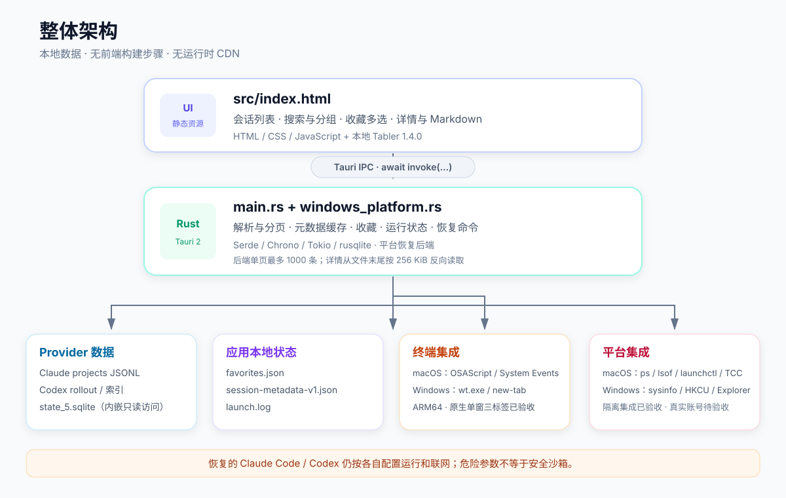

# 架构与源码结构

[文档中心](README.md) · [源码编译](BUILD.md) · [Windows 实现](WINDOWS.md) · [GitHub 更新](UPDATES.md) · [验证记录](VALIDATION.md)

## 1. 总体结构



```text
静态 UI（src/index.html）
          │ Tauri IPC
          ▼
共享 Rust 后端（src-tauri/src/main.rs）
          ├── Claude / Codex 本地存储、收藏、缓存、反向分页
          ├── 内嵌 rusqlite / SQLite 只读访问 Codex 状态库
          ├── update_checker.rs：GitHub Release 检查与更新设置
          ├── macOS：OSAScript、Terminal、launchctl、open -R
          └── Windows：sysinfo / Restart Manager、wt.exe、HKCU Run、Explorer
```

前端为静态 HTML/CSS/JavaScript，Tauri 直接加载 `src/`，没有 Node 前端打包步骤。Node 与 Chrome 只用于 mock 测试或作为某些 CLI 的运行时。

## 2. 目录结构

```text
csm-app/
├── README.md
├── docs/
│   ├── README.md                  # 任务式文档索引
│   ├── INSTALL.md / USAGE.md      # 二进制安装、授权与使用
│   ├── UPDATES.md                 # GitHub 更新检查与提醒
│   ├── DEPLOYMENT.md / BUILD.md   # 部署生命周期与编译
│   └── images/                    # 本地截图与示意图
├── src/
│   ├── index.html                 # UI、交互、更新面板与前端状态
│   └── vendor/tabler/             # 本地 Tabler CSS 与许可证
├── src-tauri/
│   ├── Cargo.toml / Cargo.lock
│   ├── build.rs
│   ├── Info.plist                 # Apple Events 用途说明
│   ├── tauri.conf.json            # 窗口、CSP、bundle 与签名配置
│   ├── capabilities/default.json
│   └── src/
│       ├── main.rs                # 共享存储、解析、恢复分发与 Rust 测试
│       ├── provider_cli.rs        # 两平台 CLI / Node 自动定位
│       ├── provider_process.rs    # Provider 身份、精确 argv、启动时间核对
│       ├── update_checker.rs      # 更新设置、Release 校验、网络与发布页
│       └── windows_platform.rs    # Windows Terminal、进程、Explorer 与 Run
├── smoke-tests/
│   ├── run-frontend-smoke.sh
│   ├── cdp.mjs
│   ├── frontend-smoke.mjs
│   ├── frontend-review-regression.mjs
│   └── windows/                   # 合成 Provider、UIA 与 owned 清理
├── scripts/
│   └── check-source-only.sh       # 检查暂存树/HEAD，拒绝附件与本地数据
├── .githooks/                     # pre-commit 与 pre-push 源码边界
└── .github/workflows/
    ├── source-only.yml            # GitHub 侧源码专用检查
    └── windows-source-check.yml   # 只测试源码，不构建/上传安装附件
```

## 3. 主要依赖

| 依赖 | 用途 |
| --- | --- |
| Tauri 2 / tauri-plugin-shell | 桌面窗口、IPC 与平台能力 |
| Serde / serde_json | 本地数据与 IPC 序列化 |
| Tokio | 异步命令与阻塞任务调度 |
| rusqlite bundled | Codex SQLite 只读访问，无需外置 sqlite3 |
| BLAKE3 | 缓存、固定快照和内容完整性校验 |
| sysinfo | Provider 进程身份、参数与启动时间 |
| Chrono / dirs | 时间与当前用户系统目录 |
| reqwest blocking + native-tls | 固定 GitHub HTTPS 更新检查 |
| semver | 比较可选 `v` 前缀的语义化 Release 标签 |
| open | 在系统默认浏览器打开已验证的 GitHub Release |
| objc2 / OSAKit | macOS 进程内 OSAScript |
| winreg / windows-sys | Windows Run 注册表与 Restart Manager |

具体版本由 `Cargo.lock` 固定；应用构建应提交锁文件。

## 4. 会话数据流

1. 根据当前用户和 `CLAUDE_CONFIG_DIR` / `CODEX_HOME` 确定存储根。
2. 枚举 Claude JSONL、Codex rollout、索引和 SQLite 元数据。
3. 缓存只保存标题、计数、路径等元数据，不持久化消息正文。
4. 详情首页记录文件长度和完整内容哈希，返回最新消息与快照令牌。
5. 向上翻页携带同一令牌，并校验固定前缀；正常追加不移动分页基准。
6. 导出沿用验证后的后端路径，流式/分段写入，不经过前端预取整段历史。
7. 恢复前重新验证项目目录、CLI、Provider、session ID 和运行状态。

缓存与快照更重视一致性，因此大型文件的未变化复核和追加仍可能需要完整读取旧前缀。

## 5. 恢复与重复保护

- Claude 固定参数：`--dangerously-skip-permissions -r <session-id>`。
- Codex 固定参数：`--dangerously-bypass-approvals-and-sandbox resume <session-id>`。
- CLI 先解析为自动发现的绝对路径，工作目录单独校验。
- 已运行判断要求 Provider 角色、完整恢复参数与 session ID 精确匹配，不是任意子串。
- 启动前记录既有匹配进程身份，启动后只计算新身份。
- 完整启动集合需连续稳定匹配 1000 ms，任何不完整观察都会重置稳定计时。
- 批量只作用于当前 Provider；每个剩余非空批次创建一个新原生 Terminal 窗口。
- 生产路径不批量关闭 Terminal、不终止既有 CLI，也不在失败后自动清理。

### macOS 路径

单开和批量使用进程内 `OSAScript`，通过 Terminal Apple Events 与 System Events 创建窗口/标签。`executeAndReturnError` 的可空返回和 `OSAScriptErrorMessageKey` 必须正确处理。

**当前保持同步主线程 IPC。** 曾尝试移入 `spawn_blocking`，真实 Terminal 中出现命令停留于提示符及 Apple Event 超时，因此实验已撤回。自动化期间仍可能阻塞 UI。

AppleScript 对象模型可能把一个可见窗口中的多个标签暴露成多个 window ID；真实原生结构需另行检查 AX，不能只数 AppleScript 对象。

### Windows 路径

阻塞启动通过 `tokio::task::spawn_blocking` 执行。`wt.exe -w new` 与多个 `new-tab` 通过逐项 argv 调用，不用 `cmd /c` 拼接整段命令。工作目录在 UTF-16LE Base64 编码的 PowerShell 中用 `Set-Location -LiteralPath` 设置。

Restart Manager 只读查询 rollout 持有者，不调用 `RmShutdown` / `RmRestart`。详细规则见 [WINDOWS.md](WINDOWS.md)。

## 6. GitHub 更新架构

```text
前端“更新”面板 / 启动与 6 小时周期任务
          │ get/save/check/dismiss/open IPC
          ▼
update_checker.rs
          ├── 原子读写 update-settings.json
          ├── owner/repository 严格校验
          ├── spawn_blocking 执行 GitHub HTTPS 请求
          ├── latest stable Release + semver 比较
          └── 校验当前仓库的发布页后交给系统浏览器
```

请求边界：

- 只接受公开 `owner/repository`，空仓库不联网。
- API 固定为 `https://api.github.com/repos/.../releases/latest`。
- 连接超时 5 秒、总超时 12 秒、最多 3 次重定向、仅 HTTPS、响应最大 1 MiB。
- 拒绝草稿、预发布、非语义化标签和外部发布地址。
- 设置互斥、唯一临时文件与原子保存；损坏文件不静默覆盖。
- 前端同仓库并发检查复用一个 Promise；切换仓库后忽略旧响应。
- 后台失败静默，手动失败在面板中显示。
- 不自动下载、替换、安装或重启。

## 7. 前端状态与安全

- Provider 各自维护搜索、过滤、选择和详情状态。
- 收藏批量显式携带 Provider，启动时不会自动读取收藏进行恢复。
- Release 名称、版本和会话正文使用文本节点/转义，不作为 HTML 执行。
- 更新对话框支持 Escape、焦点返回和基本 Tab 焦点循环。
- 本地 Tabler，无运行时 CDN。
- 当前 `csp: null` 且 `dangerousDisableAssetCspModification: true`，这是发布前需要收紧的明确安全边界。

## 8. 测试架构

| 层级 | 入口 | 范围 |
| --- | --- | --- |
| Rust 普通测试 | `cargo test` | 解析、缓存、命令构造、版本与设置逻辑 |
| 前端 CDP mock | `run-frontend-smoke.sh` | 真实前端 + 模拟 IPC，不访问真实会话/GitHub |
| 独立审查回归 | `frontend-review-regression.mjs` | 关键竞态、失败重试与更新空配置 |
| macOS opt-in | 指定 ignored 测试 | 真实 Terminal、合成 Provider、严格 owned 清理 |
| Windows 隔离 GUI | `smoke-tests/windows/` | WebView2、UIA、合成 Provider 与唯一标签清理 |

不能对所有 ignored 测试直接使用 `--include-ignored`。真实测试的授权、对象所有权与清理约束见 [../smoke-tests/README.md](../smoke-tests/README.md)。
