# 功能与界面示例

[文档中心](README.md) · [安装与授权](INSTALL.md) · [使用指南](USAGE.md) · [GitHub 更新](UPDATES.md) · [验证记录](VALIDATION.md)

> 以下第 1–7 节为 Chrome 前端图片，使用模拟 IPC 与 `/mock/...` 路径；第 8–9 节为 Windows 隔离夹具与原生标签。`docs/images/` 另含作者本机 macOS / Windows 安装版实机截图（`csm-macos-live-*.png`、`csm-windows-live-*.png`），只显示会话标题，不含消息正文。示例截图证明对应记录的界面渲染，不等于所有平台或真实账号恢复均已验收。

## 1. Claude 会话管理

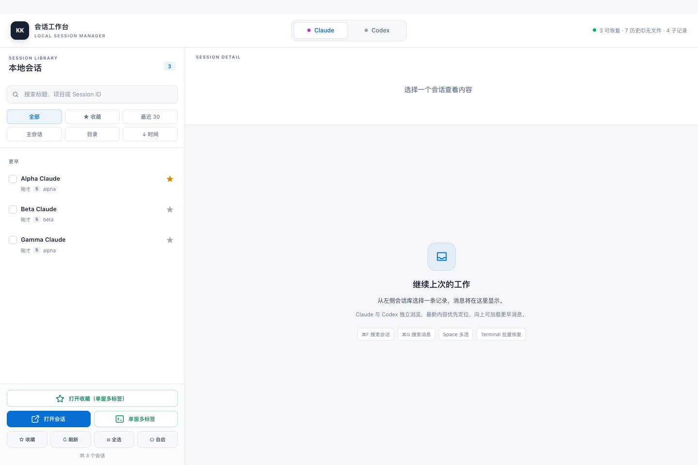

- Claude / Codex 顶部切换。
- 搜索、过滤、收藏筛选和目录分组。
- 全选、多选与收藏批量入口。
- 会话标题、项目路径、消息数量与更新时间。

## 2. 最新消息与 Markdown 详情

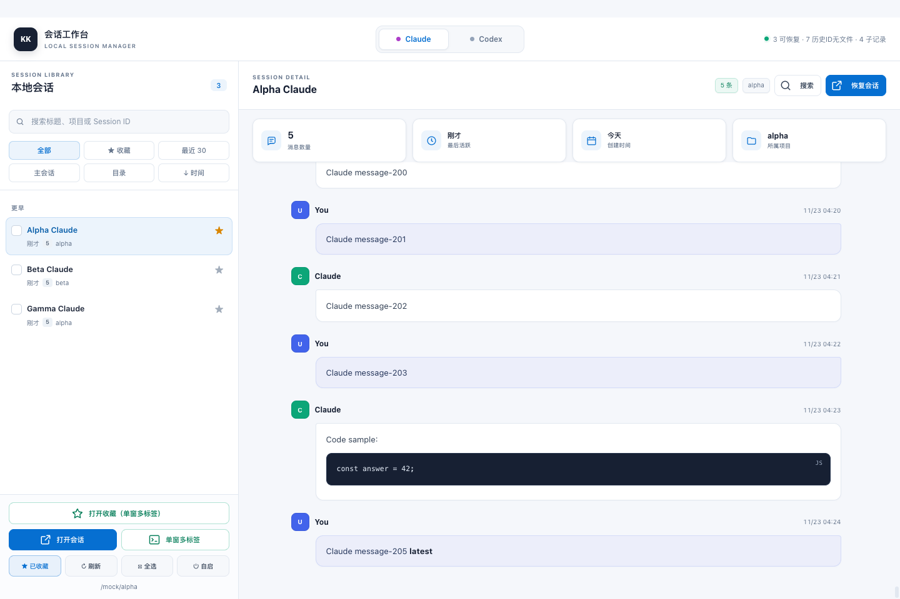

- 默认定位最新消息。
- 向上加载更早历史，固定首页快照避免后续追加打乱分页。
- Markdown、代码块与 HTML 转义。
- 消息内搜索只针对当前已加载内容。

## 3. 全选、多选与单窗多标签

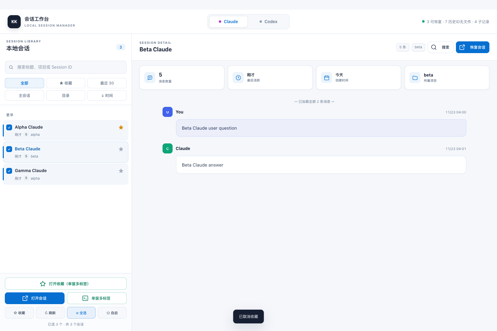

每个非空批次创建一个新的原生 Terminal 窗口，窗口内包含所选数量的顶部标签。完全重复的批次不新增窗口；不相交的后续批次可继续创建新窗口。

- 收藏保存在本机；电脑重启后点“打开收藏（单窗多标签）”可恢复当前 Provider 的全部收藏。
- 也可勾选任意多条已停止会话，点“单窗多标签”只打开选中的这一批。

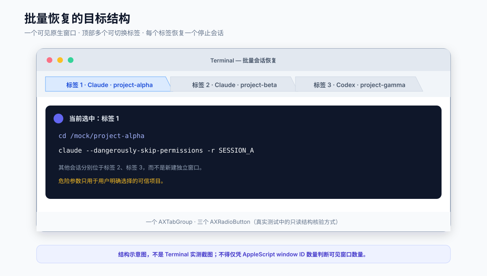

上图是结构示意。macOS 的真实 AX 和 Windows UIA 验收边界见 [VALIDATION.md](VALIDATION.md)。

## 4. Codex 主会话与子线程

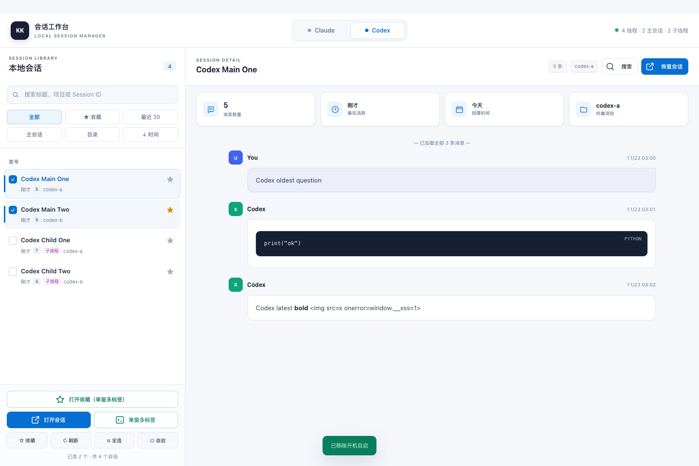

- 主会话与子线程标识。
- 消息数量异步补充，不阻塞整个列表。
- Codex 使用独立筛选、选择和收藏批量。
- 读取 rollout 与内嵌 SQLite 状态库，不需要外置 `sqlite3`。

## 5. 右键操作

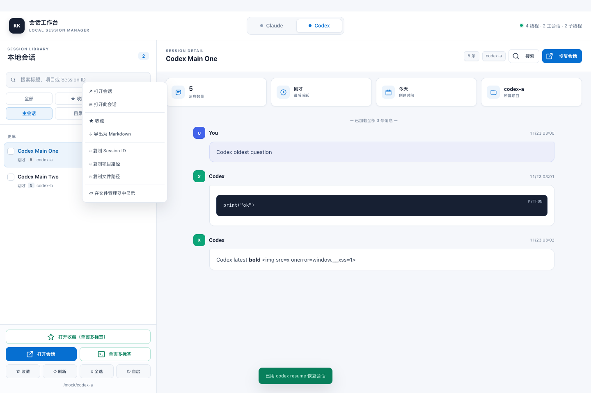

支持打开会话、导出 Markdown、复制 Session ID / 项目路径 / 文件路径，以及在 Finder / Explorer 中显示文件。Windows Explorer 的真实系统行为仍未完成实机验收。

## 6. GitHub 更新面板与新版本横幅

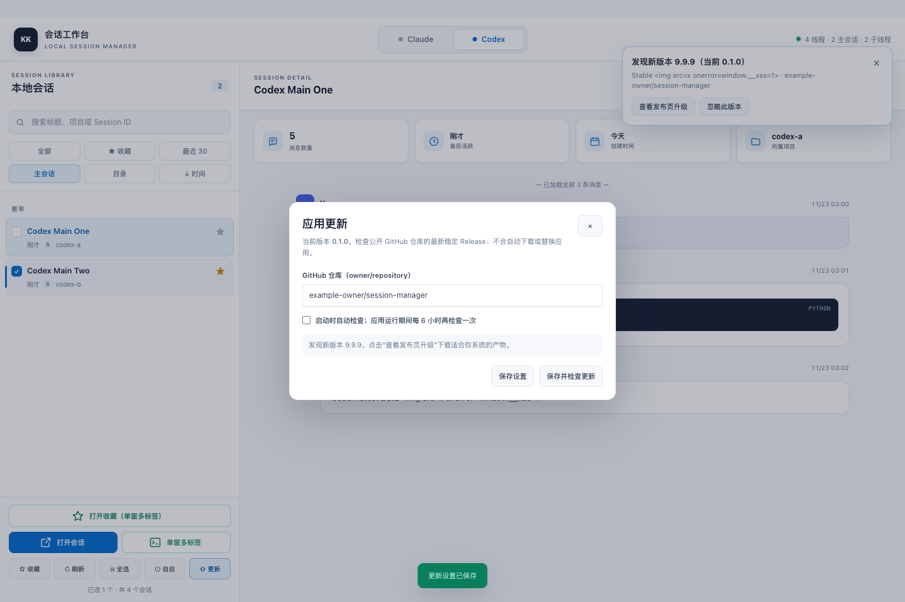

左侧“更新”可配置公开仓库、自动检查和手动检查。当前版本由运行程序提供；Release 名称以纯文本显示。

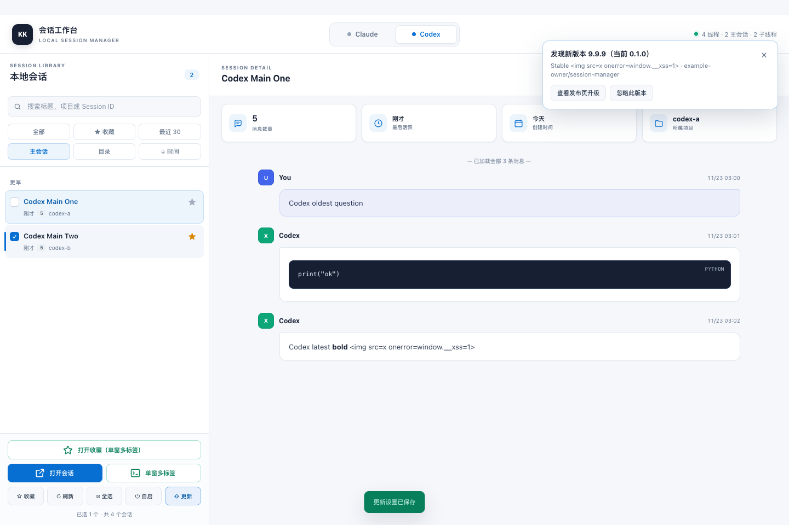

更高稳定版本会显示“查看发布页升级”“忽略此版本”和“稍后提醒”。这两张图来自前端模拟高版本场景；不是某个真实 GitHub 仓库已有新版本的证据，也不表示应用会自动下载安装。

## 7. 最小宽度布局

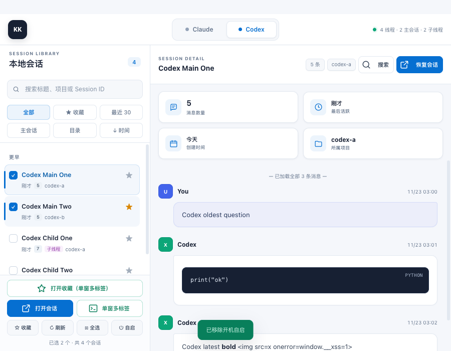

窗口最小宽度为 900px、最小高度为 600px。前端 mock 检查 900px 布局无横向页面溢出；这不是所有系统缩放和字号的完整兼容性保证。

## 8. Windows 11 ARM64 真实 WebView2

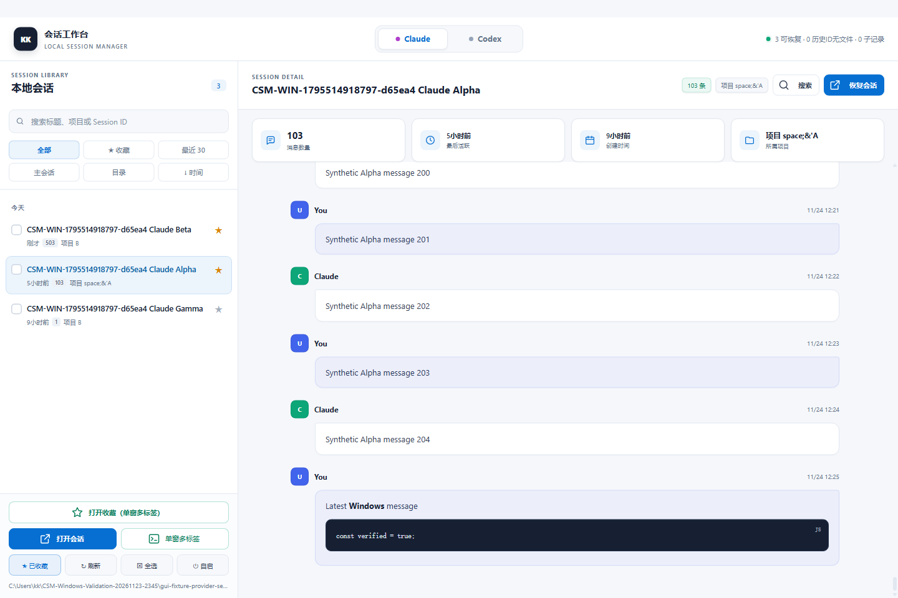

来自真实 Windows Release App + WebView2 + 合成夹具，不是 Chrome 修改 User-Agent 的截图。新增 GitHub 更新功能尚未在该旧 Windows 二进制中验收。

## 9. Windows Terminal 原生标签

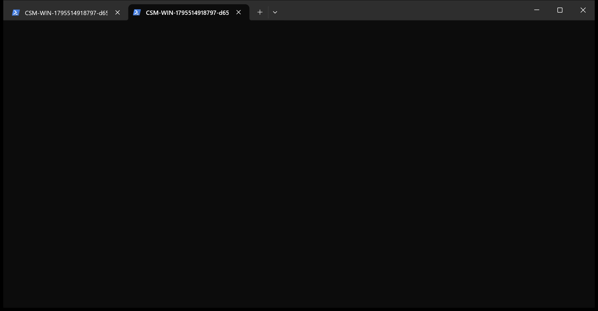

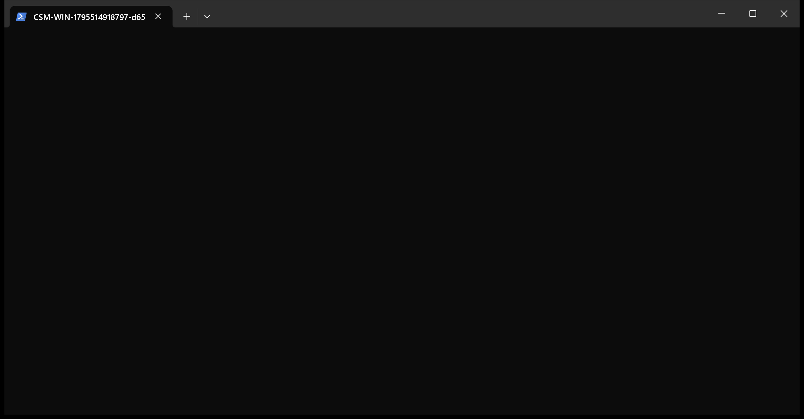

两张图片分别来自已验证所有权的 Terminal HWND。测试只操作并清理自己的合成标签，不操作用户已有 Terminal。当前 Windows 已运行会话仍不能聚焦原标签。

## 10. 视觉与资源约束

- 白色卡片式 GUI，使用系统窗口装饰。
- 本地 Tabler 1.4.0，无运行时 CDN。
- 不通过界面覆盖 Terminal 默认字体、字号、配色或布局。
- 更新提示、会话详情和导出提示使用文本渲染，不把 Release 或会话内容当 HTML 执行。

更多图片生成方式见 [images/README.md](images/README.md)。
