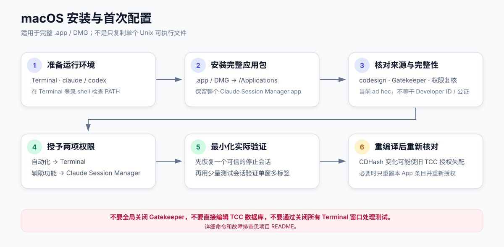

# 二进制安装与授权

[文档中心](README.md) · [返回首页](../README.md) · 下一步：[使用指南](USAGE.md) · [GitHub 更新](UPDATES.md) · 后续：[部署/更新/卸载](DEPLOYMENT.md) · 开发者：[源码编译](BUILD.md)

> **推荐路径：下载并校验二进制 → 安装 → 完成系统授权 → 打开少量可信测试会话。** 使用已发布二进制不需要 Rust、Cargo 或 Tauri CLI。

## 1. 选择产物

当前版本：`0.1.0`；Bundle ID：`com.claude.sessionmanager`。

| 平台 | 推荐文件 | 当前验收状态 |
| --- | --- | --- |
| macOS Apple Silicon | `Claude Session Manager_0.1.0_aarch64.dmg` | 当前 `/Applications` 严格签名、DMG、当前 CDHash 授权和安装版合成恢复已验收 |
| macOS Apple Silicon | 完整 `Claude Session Manager.app` | 必须保留整个 `.app`，不要只复制 `Contents/MacOS/csm-app` |
| Windows 11 ARM64 | `Claude Session Manager_0.1.0_arm64-setup.exe` | 当前用户 NSIS 更新、卸载、干净重装及最终安装路径 GUI 已验收 |
| Windows 11 ARM64 | `csm-app-windows-arm64.exe` | 独立 Release；高级用户可直接运行，不含安装器和卸载器 |

当前没有已验收的 macOS Intel/Universal 或 Windows x64 安装包。不要把 ARM64 文件当作通用包。

### 运行前准备

- Claude Code 和/或 Codex CLI 已按各自官方流程安装、初始化并登录。
- macOS：系统自带 Terminal。
- Windows：Windows Terminal、WebView2 Runtime、Windows PowerShell `powershell.exe`。
- 恢复 CLI 如果依赖 Node，应用会自动查找；完全自定义位置可用 `CSM_NODE_CLI` 指定绝对路径。
- **二进制使用不需要单独安装 Rust；Codex SQLite 读取也不需要安装 `sqlite3` 命令。**

应用不写死用户名或某台机器的 CLI 路径。自动发现和覆盖规则见 [CONFIGURATION.md](CONFIGURATION.md)。

## 2. 先核验来源和 SHA-256

请从发布者提供的交付目录或 Release 获取文件，并同时取得 `SHA256SUMS.txt` / `manifest.json`。不要只凭文件名或图标判断可信度。

### macOS

```bash
shasum -a 256 "/完整路径/Claude Session Manager_0.1.0_aarch64.dmg"
```

如果当前目录就是交付根目录，可校验清单覆盖的全部文件：

```bash
shasum -a 256 -c SHA256SUMS.txt
```

### Windows PowerShell

```powershell
Get-FileHash -Algorithm SHA256 ".\Claude Session Manager_0.1.0_arm64-setup.exe"
```

将输出的十六进制哈希与交付清单逐字比较。哈希不一致、来源不明或签名验证失败时，不要安装。

## macOS：安装 DMG（推荐）

1. 完全退出旧版 Claude Session Manager。
2. 双击 DMG 挂载。
3. 将整个 **Claude Session Manager.app** 拖入 `Applications`。
4. 推出 DMG，从 `/Applications` 启动，不要长期从 DMG 内运行。
5. 也可以在 Terminal 中启动：

```bash
open "/Applications/Claude Session Manager.app"
```

如果你拿到的是完整 `.app` 而非 DMG，同样将整个应用包放入 `/Applications`。不要只复制其中的 Unix 可执行文件。

> 当前 `/Applications` 副本通过 `codesign --verify --deep --strict`；桌面/iCloud 副本曾因 FinderInfo/resource fork 等 detritus 使 `--strict` 退出 1。推荐从 `/Applications` 使用和验收，不要把桌面副本的 strict 结果冒充安装版结果。

### 检查安装副本

```bash
codesign --verify --deep --strict --verbose=2 \
  "/Applications/Claude Session Manager.app"

codesign -d --verbose=4 \
  "/Applications/Claude Session Manager.app" 2>&1

shasum -a 256 \
  "/Applications/Claude Session Manager.app/Contents/MacOS/csm-app"
```

`CDHash` 用于核对当前二进制与 TCC 授权的绑定关系；可执行文件 SHA-256 用于与交付清单比较，两者不是同一个值。

## macOS：首次启动、Gatekeeper 与签名

当前构建使用 **ad hoc 签名**，不是 Developer ID，也没有 Apple 公证。因此：

- `codesign` 严格完整性验证通过，不等于 Gatekeeper 一定接受。
- “无法验证开发者”或“Apple 无法检查是否包含恶意软件”发生在 App 启动前，不是 Terminal 权限问题。
- 给 Terminal 勾选辅助功能、重置 TCC 或重装 CLI，不能解决 Gatekeeper 首次启动拦截。

建议顺序：

1. 先核验来源、SHA-256 和上面的严格签名。
2. 在 Finder 中按住 Control 点击 App，选择“打开”，阅读系统实际提示。
3. 只有来源和完整性均已确认、且系统提供该选项时，才由你决定是否“仍要打开”。
4. 如果提示“已损坏”、哈希不匹配或严格签名失败，不要运行，也不要靠移除 quarantine 强行启动；重新取得可信产物或从源码构建。

对于**自己构建或已经确认来源与完整性的未公证 App**，只有在理解其作用是移除下载隔离标记后，才考虑仅处理这个 App：

```bash
xattr -d com.apple.quarantine \
  "/Applications/Claude Session Manager.app"
```

属性不存在时该命令可能报错。不要全局关闭 Gatekeeper，不要使用 `spctl --master-disable`，不要关闭 SIP。公开发布应优先采用 Developer ID 和公证，而不是要求用户移除 quarantine。

## macOS：必须授予的两项权限

只有点击“打开会话”或“单窗多标签”时才需要 Terminal 自动化。授权不代表允许应用关闭你的其他窗口。

### A. Apple 自动化 / Apple Events

首次操作时允许 **Claude Session Manager 控制 Terminal**。之后可在以下位置检查：

```text
系统设置 → 隐私与安全性 → 自动化 → Claude Session Manager → Terminal
```

### B. 辅助功能 / Accessibility

批量创建原生标签需要 System Events 自动化。允许：

```text
系统设置 → 隐私与安全性 → 辅助功能 → Claude Session Manager
```

注意：

- 授权对象必须是 **App 本身**，不是只授权 `osascript`、Terminal 或 Claude Code。
- 当前版本在创建 Terminal 对象前做 Accessibility 预检；未授权应直接报错，不先创建空白窗口。
- 完成授权后完全退出并重新打开 App。
- 先用一个已停止且可信的测试会话单开，再用两个测试会话验证双标签；不要先操作当前正在使用的重要会话。



### 重编译或替换 App 后权限失效

ad hoc 应用的指定要求通常绑定 CDHash。重新编译或替换 App 后，即使系统设置里的开关仍打开，旧 `csreq` 也可能仍要求旧 CDHash。

1. 完全退出 App。
2. 对**当前 `/Applications` 副本**执行 `codesign -d --verbose=4`，确认 CDHash；不要核对另一份旧 App。
3. 确认确实是替换构建后出现的权限拒绝，再由你决定是否只重置本 App 的 Accessibility 记录：

   ```bash
   tccutil reset Accessibility com.claude.sessionmanager
   ```

4. 回到“辅助功能”：条目仍在则关闭再开启；条目已移除则重新启动 App 并再次触发批量恢复，让系统重新请求权限。
5. 完全退出并重开 App，用隔离测试会话验证。授权已经匹配并正常工作时，不要反复重置。

该命令会撤销这个 Bundle ID 的现有 Accessibility 授权，只应由用户在理解影响后执行。不要直接编辑 TCC 数据库，不要做全局权限重置。

Apple Events 与 Accessibility 是不同权限。只有 Terminal 自动化授权也确认失效时，才单独考虑：

```bash
tccutil reset AppleEvents com.claude.sessionmanager
```

这会撤销该 App 已有的 Apple Events 授权，下次操作需要重新批准，不能替代 Accessibility，也不能解决 Gatekeeper 提示。

## Windows ARM64：安装 NSIS（推荐）

1. 核验 `Claude Session Manager_0.1.0_arm64-setup.exe` 的 SHA-256。
2. 关闭旧管理器窗口；不要结束真实 Claude/Codex、Windows Terminal 或其他无关进程。
3. 运行安装器。当前 NSIS 配置为 `installMode = currentUser`，目标是不需要管理员权限的当前用户安装。
4. 从开始菜单启动 Claude Session Manager。
5. 默认安装位置为：

   ```text
   %LOCALAPPDATA%\Claude Session Manager\csm-app.exe
   ```

   具体用户目录由 Windows 当前账户决定，文档不记录验收机器的个人用户名，也不是写死的安装路径。

6. 使用与 Claude/Codex CLI 相同的 Windows 用户运行。不要为了让应用读取另一个用户目录而以管理员身份启动。

### 独立 Release（可选）

高级用户也可直接运行 `csm-app-windows-arm64.exe`。这种方式：

- 不创建开始菜单项或卸载注册项。
- 仍需 WebView2、Windows Terminal、PowerShell 和相应 CLI。
- 仍使用当前用户的会话、收藏、缓存和日志目录。
- 更新时应先退出旧进程，再完整替换为你已核验的新文件。

### Windows 签名与 SmartScreen

当前没有 Authenticode 发布者签名与信誉流程，安装器可能触发 SmartScreen。不要通过关闭 SmartScreen、长期禁用安全功能或安装来源不明的“证书修复包”解决。先确认来源与哈希；无法确认时不要运行，可从源码自行构建。公开发行应配置受信任代码签名和时间戳。

### Windows 是否需要额外权限

Windows 没有 macOS TCC 的“辅助功能/Apple Events”授权步骤。正常运行依赖：

- 当前用户能读取自己的 `%USERPROFILE%\.claude` 和 `%USERPROFILE%\.codex`。
- `wt.exe` 应用执行别名可用。
- WebView2 Runtime 与 `powershell.exe` 可用。
- CLI 能在同一用户环境中独立运行。

## 3. 安装后的最小验证

1. 打开管理器，切换 Claude / Codex，确认列表数量和目录分组。
2. 打开一条会话详情，确认最新消息、Markdown 和“加载更早”。
3. 选择一个专门准备且可信的停止会话，执行单开。
4. 再选择两个停止会话，点击“单窗多标签”。
5. 确认本次批次只创建一个新 Terminal 窗口，并有所选数量的顶部标签。
6. 重复点击同一批，确认不会重复启动旧快照。

恢复使用的精确参数及安全影响见 [USAGE.md](USAGE.md#2-恢复命令与安全提示)。如果出现错误，按 [TROUBLESHOOTING.md](TROUBLESHOOTING.md) 的症状定位，不要通过关闭全部 Terminal 窗口或删除真实会话目录来“修复”。
