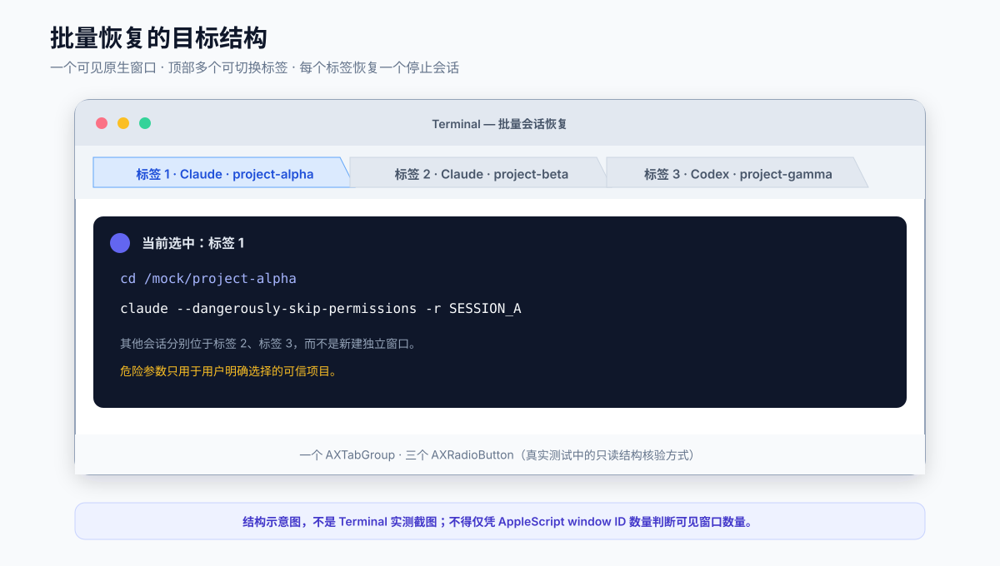

# 使用指南

[文档中心](README.md) · 上一步：[二进制安装与授权](INSTALL.md) · [GitHub 更新](UPDATES.md) · [部署/更新/卸载](DEPLOYMENT.md) · [配置与隐私](CONFIGURATION.md) · [故障排查](TROUBLESHOOTING.md)

## 1. 浏览、搜索与详情

1. 在顶部切换 **Claude** 或 **Codex**。
2. 使用搜索、过滤、收藏筛选或目录分组定位会话。
3. 点击会话查看详情；默认定位到**最新消息**。
4. 点击“加载更早”向上读取历史；消息内搜索只针对当前已加载内容。
5. 支持 Markdown、代码块和 HTML 转义。
6. 使用全选或多选准备批量操作；批量只作用于当前 Provider，不会把 Claude 与 Codex 混入同一批。

应用读取本机所有已发现项目目录中的会话，不限于启动管理器时所在的目录。默认存储位置和自定义覆盖见 [CONFIGURATION.md](CONFIGURATION.md)。

更多界面截图见 [FEATURES.md](FEATURES.md)。

## 2. 恢复命令与安全提示

应用固定使用以下恢复形式：

```bash
claude --dangerously-skip-permissions -r <session-id>
```

```bash
codex --dangerously-bypass-approvals-and-sandbox resume <session-id>
```

实际启动前会把 CLI 解析为自动发现的绝对路径，并进入原项目目录。结构示意：

```bash
cd <project-directory> && \
  env -u CLAUDE_CODE_CHILD_SESSION -u CLAUDECODE \
  [CLAUDE_CONFIG_DIR=<config-directory>] \
  <auto-detected-claude-path> --dangerously-skip-permissions -r <session-id>
```

```bash
cd <project-directory> && \
  env -u CLAUDE_CODE_CHILD_SESSION -u CLAUDECODE \
  [CODEX_HOME=<codex-directory>] \
  <auto-detected-codex-path> --dangerously-bypass-approvals-and-sandbox resume <session-id>
```

方括号仅表示按需加入，不要把占位符原样复制到 shell。

> **高风险参数提示：** 这些参数会跳过 Claude Code 权限提示，或绕过 Codex 审批与沙箱。只恢复你理解和信任的本地项目。历史消息中可能包含继续执行命令、修改文件或访问网络的指令，本管理器不会为 CLI 增加安全沙箱。具体语义以你安装的 CLI 版本及官方帮助为准。

macOS 单会话自动化还会在本次新窗口中识别 Claude Code 的 `Quick safety check:` / `Yes, I trust this folder` 提示，并尝试确认信任。因此：

- 不要对来源不明的目录使用单会话恢复。
- 如果不希望自动确认目录 Trust，应移除或改造 `build_terminal_single_script` 中的 `confirmTrustPrompt` 逻辑后自行构建。
- 不要假定批量路径会处理所有首次 Trust 或 bypass 提示。

## 3. 恢复单个会话

点击“打开会话”或右键选择打开：

- 原项目目录必须存在且仍是目录；失效时直接报错，不会静默退回用户主目录。
- 停止的会话会在新 Terminal 对象中执行恢复命令。
- macOS 已运行会话优先尝试聚焦原标签，而不是再启动旧快照。
- Windows 已运行会话会阻止重复启动；当前不能聚焦原标签。
- 后端要求新 Provider 身份、完整恢复参数和 session ID 匹配，并连续稳定核实 1000 ms，才报告成功。

恢复最终是否可用还取决于 CLI 版本、认证、Trust、数据文件是否仍存在及项目目录状态。只有 shell 提示时按 [故障排查](TROUBLESHOOTING.md#2-点击打开后只有-shell没有恢复-cli) 处理。

## 4. 批量恢复：一个批次一个新窗口、多个顶部标签



> 上图是结构示意；真实验收记录见 [VALIDATION.md](VALIDATION.md)。

电脑关机或重启后，收藏仍保存在本机。打开管理器并点 **“打开收藏（单窗多标签）”**，即可把当前 Provider 的全部收藏恢复到新窗口的多个顶部标签；也可以在列表里勾选任意多条**已停止**会话，点 **“单窗多标签”** 只打开选中的这一批。

1. 在当前 Provider 下选择多个停止会话，或使用当前 Provider 的收藏批量入口。
2. 点击“单窗多标签”。
3. 后端先过滤已运行会话。
4. 本次剩余的非空批次创建一个**新的原生 Terminal 窗口**，其中包含所选数量的可切换顶部标签。
5. 标签预创建并核对后，逐页执行恢复命令。

### 窗口和去重规则

| 场景 | 预期结果 |
| --- | --- |
| Claude A、B 首次批开 | 一个新 Claude 窗口，两个标签 |
| Claude A、B 运行中，再次批开同一批 | `opened=0, already_running=2`，不新增窗口 |
| Claude A 已运行，选择 A、C 批开 | 只为 C 创建新批次；A 保留原处 |
| 随后选择停止的 Claude C、D | 另一个新 Claude 窗口，不限制 Provider 窗口总数 |
| Claude 运行中，首次打开停止的 Codex | Codex 在自己的新窗口启动，不被 Claude 阻塞 |
| Claude 收藏批开 | 不包含 Codex 收藏 |
| Codex 收藏批开 | 不包含 Claude 收藏 |
| 重复请求完全相同 Provider/session | 不重复启动旧快照 |
| 不同 session 或不同 Provider | 不互相误判为同一运行对象 |

macOS 使用系统 Terminal 当前默认窗口设置，不依赖 tmux 或 iTerm2。Windows 使用 `wt.exe -w new` 和多个 `new-tab`，不覆盖默认字体、字号、配色或布局。

### 不要误判 AppleScript 对象数量

macOS Terminal 的 AppleScript 模型可能把同一可见窗口中的多个顶部标签暴露为不同 window ID，且每个对象只有一个 tab。**不能只按 AppleScript window ID 数量判断可见窗口数。** 原生测试需要另查 `AXTabGroup` 和 `AXRadioButton`。

生产批量代码不包含批量关闭、失败自动清理或 AX 清理。中途失败会保留已创建对象并报告错误；不要通过“关闭全部 Terminal 窗口”补救。

## 5. 导出、复制与文件管理器

右键菜单提供：

- 导出 Markdown。
- 复制 Session ID。
- 复制项目路径。
- 复制会话文件路径。
- 在 Finder / Explorer 中显示文件。

### Markdown 导出边界

- 导出固定建立时的源文件快照；之后追加的消息不属于本次导出。
- 短会话流式写出；长会话反向扫描、分段落盘，最后按从旧到新合并。
- 后端单页详情上限为 1000 条，但完整导出不等于只导出当前页。
- 导出保存到系统“文稿 / Documents”下的 `Claude Session Manager Exports`。
- 文件名包含会话 ID 前 8 位；重名追加序号，不直接覆盖。
- Unix 导出文件权限为 `0600`，临时工作区为 `0700`。
- 清理失败会返回 `cleanup_warning`，不会无条件显示完全成功。
- “完整”指该快照中应用能解析并展示的消息，不是原始 JSONL 的逐字节副本；需要原始记录时应复制对应 JSONL。

Windows Explorer 的真实系统行为仍未完成实机验收，不能把菜单存在当作已验证。

## 6. 检查 GitHub 新版本

1. 点击左侧底部 **“⇧ 更新”**。面板已内置公开仓库 `zhumengkang/claude-session-manager`，无需手动填写。
2. 按需开启自动检查，点击“保存设置”或“保存并检查更新”。
3. 发现更高稳定 Release 时，可查看发布页、忽略此版本或稍后提醒。

启动时会按配置自动检查，运行期间每 6 小时再检查一次；窗口隐藏时跳过周期检查。使用 fork 时可在面板改成自己的公开仓库；后台失败不影响会话浏览与恢复。当前不会自动下载或安装更新，完整规则见 [UPDATES.md](UPDATES.md)。

## 7. 收藏与登录自启动

- 收藏跨 Claude/Codex 保存，Codex 键带 `codex:` 前缀，避免 ID 冲突。
- 收藏批量入口按当前 Provider 过滤。
- 可开启“登录后启动管理器”，但 `should_open_favorites()` 当前固定为 `false`：**登录只打开管理器，不会自动批量恢复收藏，也不会自动创建 Terminal 窗口。**
- 自启动更新和卸载见 [DEPLOYMENT.md](DEPLOYMENT.md)。

## 8. 查看日志与保护隐私

日志可用于定位 CLI 发现、Terminal 自动化和启动确认问题，但可能包含本机路径、错误文本、Terminal 对象 ID 或 TTY。分享前必须脱敏。

- macOS：`~/Library/Logs/Claude Session Manager/launch.log`
- Windows：`%LOCALAPPDATA%\Claude Session Manager\Logs\launch.log`

不要公开提交真实 JSONL、rollout、`state_5.sqlite`、认证文件、令牌、Cookie 或完整会话正文。详细数据边界见 [CONFIGURATION.md](CONFIGURATION.md)。
